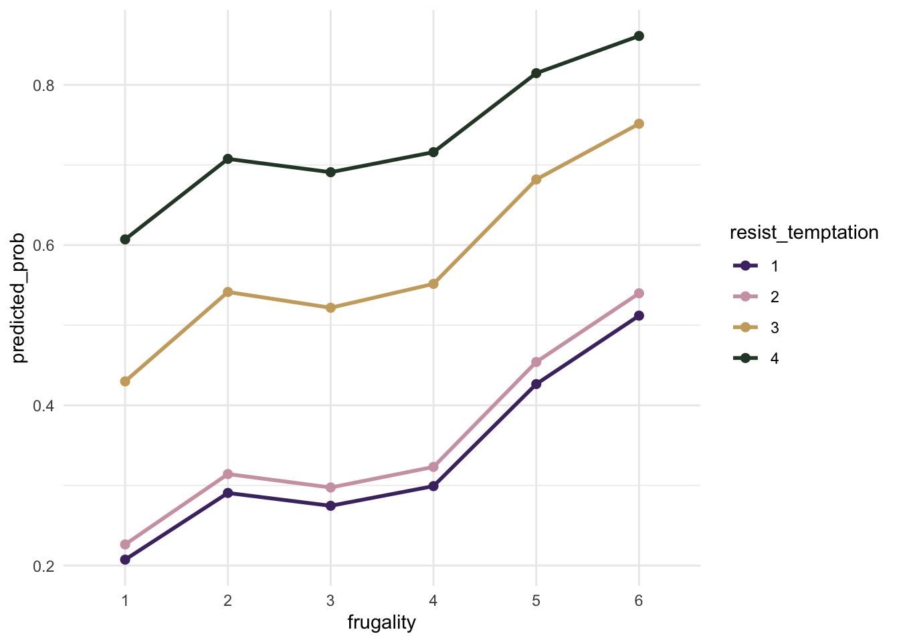

# Spending Habits Analysis & Prediction

Behavioral analysis using survey data to understand the psychological factors that influence financial decision-making and spending control.

📊 **[View Full Analysis](https://ashleymikali.com/projects/spending-behavior-model/spending-habits-analysis.html)**

## Project Overview

This project explores the relationship between psychological traits and self-reported spending habits using data from the National Financial Well-Being Survey. The analysis identifies which behavioral and personality factors are most predictive of financial discipline.

### Research Question

What psychological and behavioral traits best predict whether someone reports having "excellent" control over their spending habits?

### Dataset

- **Source:** National Financial Well-Being Survey
- **Size:** 6,000+ survey responses
- **Variables:** Self-reported psychological traits, financial behaviors, and spending habits
- **Key Predictors:** Frugality, resistance to temptation, follow-through, impulsivity, financial confidence

## Methodology

### Data Preparation

- Cleaned and validated survey responses
- Handled missing data and inconsistent entries
- Binary outcome variable: "Excellent spending habits" vs. other categories
- Standardized predictor variables for model interpretability

### Statistical Modeling

**Approach:** Binary logistic regression with stepwise feature selection

**Model Selection Process:**
- Compared models using AIC (Akaike Information Criterion) and BIC (Bayesian Information Criterion)
- Cross-validation to assess model stability
- Selected BIC-optimized model for final interpretation (favors parsimony)

**Final Model Predictors:**
1. **Frugality** - Most significant predictor (strongest positive association)
2. **Resistance to temptation** - Second strongest predictor
3. Follow-through on financial commitments
4. Impulsivity (negative association)
5. Confidence in achieving financial goals

### Model Evaluation

- Assessed model fit and residuals
- Checked for multicollinearity (VIF scores)
- Validated assumptions of logistic regression
- Created visualizations of predicted probabilities

## Key Findings

**Primary Insights:**
- Frugality and the ability to resist temptation are the strongest predictors of perceived spending control
- Personality traits matter more than demographic factors in predicting financial discipline
- The relationship between psychological traits and spending habits is non-linear

**Statistical Results:**
- Model achieved strong predictive performance on held-out validation data
- Clear separation in predicted probabilities between high and low frugality/temptation resistance
- Results remained stable across cross-validation folds

## Visualizations

### Predicted Probabilities by Key Traits


*This visualization shows how the probability of reporting excellent spending habits increases with higher frugality and resistance to temptation scores.*

## Technical Stack

- **Language:** R
- **Framework:** Quarto for reproducible research
- **Statistical Packages:** 
  - `tidymodels` - Model building and validation
  - `MASS` - Stepwise selection
  - `car` - Regression diagnostics
  - `broom` - Model tidying
- **Visualization:** `ggplot2`
- **Interactive Tools:** Shiny (in development)

## Repository Structure

```
spending-behavior-model/
├── data/                                # Survey data
├── shiny-apps/                          # Interactive visualization (WIP)
├── spending-habits-analysis.qmd         # Main analysis (Quarto)
├── spending-habits-analysis.html        # Rendered analysis
├── spending-habits-analysis_files/      # Generated figures
└── README.md                            # This file
```

## Running the Analysis

### Prerequisites
```r
install.packages(c("tidyverse", "tidymodels", "MASS", "car", "broom", "ggplot2"))
```

### Reproduce the Analysis
1. Clone this repository
2. Open the R project or set working directory
3. Render the Quarto document:
```bash
quarto render spending-habits-analysis.qmd
```

## Future Development

- [ ] **Interactive Shiny App** - Allow users to explore how different trait combinations affect predicted spending control
- [ ] **Machine Learning Extension** - Compare logistic regression with random forest and XGBoost
- [ ] **Causal Analysis** - Explore potential causal relationships using sensitivity analysis
- [ ] **Survey Methodology Documentation** - Add detailed notes on survey design and potential biases

## What This Project Demonstrates

✅ **Survey data analysis** - Working with large-scale behavioral survey data  
✅ **Statistical modeling** - Logistic regression, model selection, cross-validation  
✅ **Feature engineering** - Thoughtful predictor selection and transformation  
✅ **Model diagnostics** - Thorough validation and assumption checking  
✅ **Clear communication** - Translating statistical findings for non-technical audiences  
✅ **Reproducible research** - Documented analysis with Quarto  

## Reflections

This project started as a regression assignment and evolved into a meaningful exploration of behavioral economics and personal finance. Key learning outcomes included:

- The importance of thoughtful feature selection in survey research
- How to balance model complexity with interpretability
- Techniques for handling messy, real-world survey data
- The value of visualizing predicted probabilities to communicate model results

## Connect

**Ashley Russell-Raglin**
- Portfolio: [ashleymikali.com](https://ashleymikali.com)
- GitHub: [@ashleymikali](https://github.com/ashleymikali)
- Email: ashkalirussell@gmail.com

## License

This project is open source for educational purposes. Survey data is used in accordance with the National Financial Well-Being Survey data use agreement.